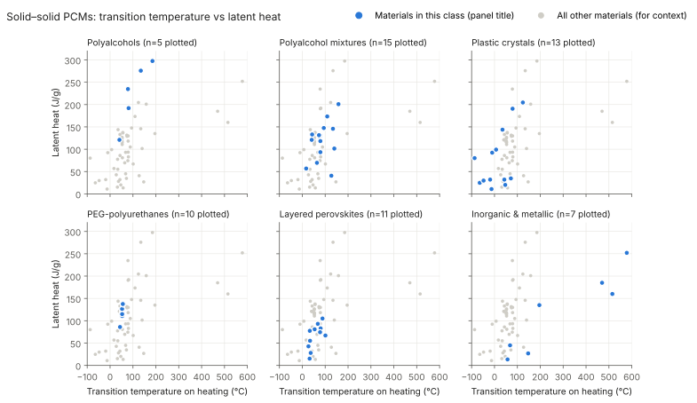
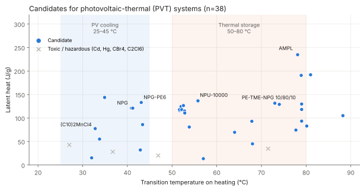
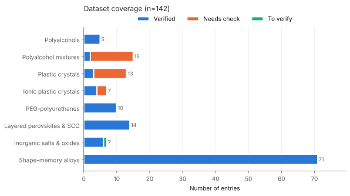
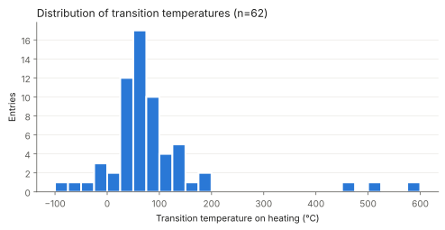

# Solid–Solid Phase Change Materials (SS-PCM) Dataset

An open, curated dataset of **solid–solid phase change materials** for thermal energy storage:
transition temperatures, latent heats, and related properties, with sources.

> **Status: v0.3 (63 entries).** The literature holds roughly a few hundred distinct SS-PCMs
> (~1,000–2,000 entries counting mixtures and polymer formulations). See `data/class_overview.csv`.

## Contents
| File | Description |
|---|---|
| `data/ss_pcm_dataset.csv` | Main dataset (one row per material/sample) |
| `data/data_dictionary.md` | Column definitions and units |
| `data/class_overview.csv` | SS-PCM classes, examples, approximate counts and property ranges |
| `ml/` | ML-ready files: SMILES + RDKit descriptors, perovskite and mixture features, targets ([ml/README.md](ml/README.md)) |
| `cfd/` | CFD inputs: ρ, k, cp, latent heat, apparent-cp tables ([cfd/README.md](cfd/README.md)) |
| `figures/` | Overview plots (SVG) (regenerate with `scripts/make_figures.py`) |
| `scripts/build_csv.py` | Source of the curated records; regenerates the CSV |
| `scripts/validate.py` | Sanity checks (ranges, DOIs, T < melting point, duplicates) |

## Coverage (v0.3)
| Class | Rows |
|---|---|
| Organic – polyalcohols (NPG, PG, PE, TAM, AMPL) | 5 |
| Organic – polyalcohol mixtures (PE/TME/NPG ternaries, NPG+PE) | 15 |
| Organic – molecular plastic crystals (incl. barocaloric adamantanes) | 13 |
| Polymer – PEG-polyurethanes | 10 |
| Organometallic – layered hybrid perovskites (Cu, Zn, Mn, Co, Cd, Hg, Ni) | 13 |
| Inorganic – sulfates, AgI, KHF2, VO2 | 6 |
| Metallic – NiTi | 1 |

## Figures





## Scope
**Included:** materials whose storage transition is a true solid-to-solid transition
(order–disorder, plastic-crystal, polymorphic, martensitic, superionic, metal–insulator).

**Excluded:** "form-stable" / "shape-stabilized" composites (e.g. paraffin in HDPE, PEG in porous carbon),
which are macroscopically solid but melt at the microscale. These could be added later as a separate class.

## Data quality
Each row has a `verification_status`:
- **`verified`** (39 rows): value read directly from the cited source (`doi` or `source_url`).
- **`needs_check`** (23 rows): source identified, but the value is derived (ΔH = T·ΔS), read from an OCR'd scan, or taken from an author manuscript. Confirm against the original before publishing.
- **`to_verify`** (1 row, KHF2): no primary source found yet.

Reported values depend on DSC heating rate, sample purity, and onset vs. peak definition. See `T_type` and `notes`.

## Usage
```python
import pandas as pd
df = pd.read_csv("data/ss_pcm_dataset.csv")
df[df.verification_status == "verified"].sort_values("dH_heat_Jg", ascending=False)
```

## Contributing
1. Add a record in `scripts/build_csv.py` (or edit the CSV) with a DOI.
2. Run `python scripts/build_csv.py && python scripts/validate.py`, then `build_ml.py`, `build_cfd.py`, `make_figures.py` (needs `rdkit`, `matplotlib`).
3. Open a pull request.

Priority next steps: confirm `needs_check` rows; source KHF2; add NPG–TAM, PG–TAM and AMPL–TAM binaries; extend the perovskite series to n = 8–18; add carboranes and ionic plastic crystals.

## Key sources
- Lloveras et al., *Nat. Commun.* 10, 1803 (2019) — doi:10.1038/s41467-019-09730-9
- Serrano et al., *J. Energy Storage* 55, 105677 (2022) — doi:10.1016/j.est.2022.105677
- Doppiu et al., *Materials* 12, 3658 (2019) — doi:10.3390/ma12223658
- Prats et al., *Mater. Chem. Front.* (2025) — doi:10.1039/d5qm00712g
- *Sci. Rep.* 12, 14646 (2022) — doi:10.1038/s41598-022-17390-x
- Cao et al., *RSC Adv.* (2017) — doi:10.1039/c7ra00405b
- Shaviv, Westrum et al., *J. Chem. Thermodyn.* 21, 631 (1989) — doi:10.1016/0021-9614(89)90177-8
- Muramoto et al., *Front. Mater.* 7 (2020) — doi:10.3389/fmats.2020.00005
- Sharar et al., NiTi martensitic TES — arXiv:1901.06990
- NIST Chemistry WebBook phase-change data (PE, TAM, AMPL, adamantane, cyclohexane, CCl4)
- Zhou, Zhang & Fang, *Chem. Ind. Eng. Prog.* 40, 1371 (2021) — doi:10.16085/j.issn.1000-6613.2020-0875
- Li et al., Colossal barocaloric effects in plastic crystals — arXiv:1808.07834
- Aznar et al., *Appl. Mater. Today* 23, 101023 (2021) — doi:10.1016/j.apmt.2021.101023
- Benson & Christensen, SERI/TP-255-2494 (1984)
- *Mater. Sci. Forum* 978, 407 (2020) — NPG/PE binary

## Changelog
- **v0.4**: added figures, `ml/` (SMILES, descriptors, targets) and `cfd/` (thermophysical inputs, apparent-cp tables); cp from NIST WebBook; ρ and k from Benson & Christensen 1984.
- **v0.3**: +35 rows — 10 layered perovskites, 13 PE/TME/NPG ternaries, 2 NPG+PE binaries, 10 plastic crystals; new `needs_check` status.
- **v0.2**: sourced 9 previously unverified rows (PE, TAM, AMPL, adamantane, cyclohexane, CCl4, AgI, VO2, NiTi); corrected PE (269→297.5 J/g), TAM (285→275.8), AMPL (264→234.7), NiTi (24→13.5), VO2 (51→45); removed Fe (not a practical PCM); added `source_url` column.
- **v0.1**: initial 29-row seed.

## License
Data: CC BY 4.0 · Code: MIT
